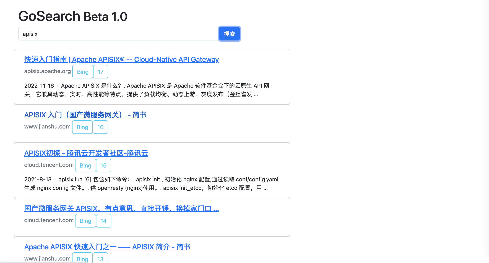

# GoSearch

Demo: [http://127.0.0.1/](http://127.0.0.1/)

## Diagram


## Project Overview

GoSearch aggregates search engine results, delivering instant loading, a sleek UI, dark mode support, and even custom weight sorting! Here’s what it does:

**Key Features:**
- Configure weights for search engines
- Configure weights for domains
- Optimize search engine result rendering

[Roadmap](note/roadmap.md)

## Software Architecture

Built in Go, this project combines frontend and backend in a single application. It forwards requests to search engines, processes the results (cropping, aggregating, and displaying them), and serves them efficiently.

**Dependencies:**
- goquery
- yaml.v2
- bootstrap5 (since the UI is simple, no separate frontend service is needed)

[Sorting algorithm implementation details](note/algorithm.md)

## Usage Instructions

### Getting Started

#### Docker Deployment
```
docker run -d -p 80:80 zyhui98/gosearch:v1.0
```
Access the service at: [http://127.0.0.1](http://127.0.0.1)


#### Local Development
```
go run main.go
```

### Configuration

The configuration file is located at `configs/config.yml` and contains settings for the server, search engines, and domains.

```
server:
  debug: false
  port: 80

search:
  - name: Baidu
    domain: www.baidu.com
    weight: 1 # search engine weight factor
    positionWeight: 1 # search engine natural sorting weight factor
    score: 0 # additional score assigned by the search engine
    enable: false # whether to enable
  - name: Bing
    domain: cn.bing.com
    weight: 1
    positionWeight: 1
    score: 10
    enable: true
  - name: Google
    domain: www.google.com
    weight: 1
    positionWeight: 1
    score: 10
    enable: false
  - name: WeChat Public Account
    domain: weixin.sogou.com
    weight: 1
    positionWeight: 1
    score: 10
    enable: true

site:
  - domain: www.csdn.com
    weight: 1 # domain weight factor
    score: 0 # additional score assigned by the website
  - domain: zhuanlan.zhihu.com
    weight: 1
    score: 0
  - domain: www.yuanbiguo.com
    weight: 1
    score: 0
  - domain: juejin.cn
    weight: 1
    score: 0
```

## Contributing

To contribute to this project:
- Fork the repository
- Create a new branch named `Feat_xxx`
- Submit your code
- Open a pull request
